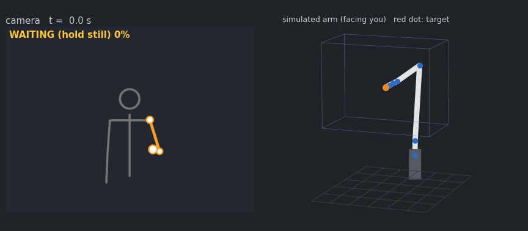

# pose-mimic-arm

[English](README.md) | **한국어**

내 팔을 따라 움직이는 시뮬레이션 6축 로봇팔입니다. 웹캠으로 사람을 찍으면 [MediaPipe Pose](https://developers.google.com/mediapipe/solutions/vision/pose_landmarker)가 어깨·팔꿈치·손목의 3D 위치를 찾고, RViz2 속 로봇팔이 거울처럼 손 움직임을 따라 합니다. 실제 로봇도, 깊이 카메라도 필요 없습니다.



*위 데모는 내장된 가상 사람(`source:=synthetic`)으로 만들었기 때문에 어떤 PC에서도 실행됩니다. 카메라 화면은 웹캠 앱처럼 좌우 반전해서 보여 줍니다.*

ROS 2 Humble · Python · 계산은 numpy만 사용(MoveIt, KDL 없음)

## 동작 원리

```
웹캠 / 영상 ──▶ pose_node ───────────────────────▶ ik_node ─────────────────▶ RViz2
               MediaPipe Pose (3D 랜드마크)        움직임 다듬기              robot_state_publisher
               팔 매핑: 원점, 필터, 범위 제한      감쇠 최소제곱 IK
                    │ /mimic/target (PointStamped)       │ /joint_states
```

1. **웹캠 한 대로 팔의 3D 위치 찾기.** MediaPipe의 *world landmarks*가 어깨·팔꿈치·손목을 미터 단위로 주므로 깊이 카메라가 필요 없습니다. 손 위치는 어깨 기준으로 계산합니다. 그래서 몸을 흔들거나 자리를 옮겨도 로봇은 움직이지 않습니다.
2. **튀지 않고 시작하기.** 팔을 2초 동안 가만히 두면 그 자세를 원점으로 잡습니다. 그다음부터 목표 위치는 `홈 + 0.6 × (손 − 원점일 때의 손)`이고, 축은 거울 방향입니다.
3. **차례대로 거르기.** 원점 주변 7mm 데드밴드, 프레임 간 이동 5cm 제한(검출이 한 번 튀어도 팔이 날아가지 않음), 지수 이동 평균(α = 0.4), 도달 가능 영역으로 제한하는 순서입니다.
4. **놓쳤을 때 안전하게.** 팔이 화면에서 사라지면 로봇은 그 자리에 멈춥니다. 3초가 지나면 새 원점을 기다립니다. 그래서 사람이 다른 위치로 돌아와도 로봇이 갑자기 끌려가지 않습니다.
5. **로봇이 낼 수 있는 움직임으로.** `ik_node`가 30Hz로 최근 목표 4개를 평균하고, 속도를 0.8m/s, 가속도를 4m/s²로 제한합니다.
6. **관절 각도 풀기.** 감쇠 최소제곱 IK가 손끝을 목표 위치에 두고 사람 쪽을 가리키게 합니다. 손목 회전(roll)은 자유입니다. 팔 모양은 RViz가 그리는 URDF에서 그대로 읽기 때문에 계산과 화면이 어긋날 수 없습니다.

### 거울 매핑

| 사람(카메라가 본 모습) | 로봇 손끝 |
|---|---|
| 손을 카메라 쪽으로 | 사람 쪽으로 뻗음(+x) |
| 손을 위로 | 위로(+z) |
| 손을 내 왼쪽으로 | 로봇의 오른쪽, 즉 마주 본 내 입장에서 왼쪽 |

매핑은 파라미터 하나(`axis_map`, 기본값 `-z,-x,-y`)로 정합니다. 각 항목은 로봇 x, y, z를 움직일 카메라 축입니다.

## 빠른 시작

Ubuntu 22.04, ROS 2 Humble, Python 3.10이 필요합니다.

```bash
mkdir -p ~/mimic_ws/src && cd ~/mimic_ws/src
git clone https://github.com/kimmandy/pose-mimic-arm.git
pip install mediapipe            # 0.10.21로 시험함
cd ~/mimic_ws && colcon build --symlink-install
source install/setup.bash

ros2 launch pose_mimic_arm sim.launch.py                       # 가상 사람, 카메라 불필요
ros2 launch pose_mimic_arm sim.launch.py source:=webcam        # 웹캠 (/dev/video0)
ros2 launch pose_mimic_arm sim.launch.py source:=video video_path:=$HOME/clip.mp4
```

웹캠을 쓸 때는 상체가 다 보이도록 1.5~2.5m 떨어져 서세요. 오른팔을 앞으로 내민 채 상태가 `FOLLOWING`이 될 때까지 가만히 있다가 움직이면 됩니다. `show_window:=true`를 붙이면 OpenCV 창이 뜨고 `r` 키로 원점을 다시 잡을 수 있습니다. 왼팔을 따라 하게 하려면 `arm:=left`를 쓰세요.

## 측정 결과

노트북(Intel i5-1340P)에서 단일 스레드 Python으로 측정했습니다.

| 항목 | 결과 |
|---|---|
| IK, 홈 근처의 도달 가능한 자세 500개(위치 + 방향) | 500/500 수렴, 반복 중간값 6회, 1회 1.4ms |
| IK, 작업 공간 안팎의 무작위 목표 2,000개를 범위 제한 후 연속으로 풀기 | 2,000/2,000 오차 1mm 이내 |
| 전체 파이프라인, 가상 사람 24초, 30Hz | 도달 실패 0/720프레임, IK 평균 0.37ms |
| 추종 중 손끝이 목표보다 뒤처진 거리 | 중간값 3.7mm, 상위 5% 18.4mm(속도·가속도 제한으로 일부러 둔 지연) |
| ROS 2 실행(`ros2 launch`, 가상 사람) | `/joint_states` 30Hz, `ik_node` 보고 5초 구간별 평균 추종 오차 1.8~7.2mm |

## 설계 메모

추측이 아니라 측정을 보고 정한 것들입니다.

- **작업 공간 = 박스 ∩ 구.** 처음에는 홈 주변의 박스로 충분해 보였지만, 격자점 512개 중 16개에 닿지 못했습니다. 박스의 먼 위쪽 모서리가 어깨에서 0.75m인 팔 길이 밖에 있었습니다. 게다가 한 번 도달하지 못하면 목표가 다시 안으로 들어와도 관절 한계에 걸린 채 빠져나오지 못했습니다. 그래서 반경 0.72m 구로도 제한하고, 이전 해에서 시작한 IK가 실패하면 홈 자세에서 다시 풉니다.
- **오차에 따라 바뀌는 감쇠.** 감쇠를 고정(λ = 0.05)하면 500번 중 1번은 마지막 1mm를 너무 천천히 좁히다가 반복 한도에 걸렸습니다. λ를 오차 크기에 비례시키자 500/500이 됐고 반복 중간값도 7회에서 6회로 줄었습니다.
- **방향 전체 대신 손끝 방향만.** 회전 세 축을 모두 고정하면 쓸 수 있는 작업 공간이 줄어듭니다. 그래서 손끝이 가리키는 방향만 맞추고 손목은 필요한 만큼 돌게 했습니다.
- **카메라 축을 실제 영상으로 확인.** MediaPipe world landmarks는 여러 프레임에서 이미지 좌표와 x(오른쪽) +0.99~+1.00, y(아래) +0.55~+0.99의 상관을 보였습니다. 매핑이 가정한 축 방향이 맞습니다.

## 토픽

| 토픽 | 타입 | 보내는 노드 | 내용 |
|---|---|---|---|
| `/mimic/target` | `geometry_msgs/PointStamped` | pose_node | `base_link` 기준 손끝 목표(m) |
| `/mimic/state` | `std_msgs/String` | pose_node | `WAITING 40%`, `FOLLOWING`, `LOST` |
| `/mimic/image` | `sensor_msgs/Image` | pose_node | 추적한 팔을 그린 카메라 화면 |
| `/joint_states` | `sensor_msgs/JointState` | ik_node | RViz용 관절 각도 |
| `/mimic/tcp` | `geometry_msgs/PointStamped` | ik_node | 손끝의 실제 위치 |
| `/mimic/markers` | `visualization_msgs/MarkerArray` | 둘 다 | 사람 팔, 목표, 손끝, 작업 공간 |

`/mimic/target`이 연결 지점입니다. 실제 로봇팔의 직교 좌표 서보 인터페이스가 `ik_node` 대신 이 토픽을 구독하면 됩니다.

## 파라미터

`pose_node`: `source`(synthetic / webcam / video), `camera_index`, `video_path`, `arm`, `gain`(0.6), `axis_map`, `home`([0.45, 0, 0.55] m), `still_seconds`(2.0), `deadband`(0.007 m), `max_jump`(0.05 m), `ema_alpha`(0.4), `lost_reset_seconds`(3.0), `workspace_lower` / `workspace_upper` / `workspace_center` / `workspace_radius`, `mirror_view`(true), `show_window`(false).

`ik_node`: `rate`(30 Hz), `smooth_window`(4), `max_speed`(0.8 m/s), `max_accel`(4.0 m/s²), `orientation`(axis / full), `home_joints`, `urdf_path`, `target_timeout`(1.0 s).

## 구조

```
pose_mimic_arm/
  kinematics.py   URDF 체인, FK, 자코비안, 감쇠 최소제곱 IK
  mapping.py      팔 → 목표 상태 기계, 작업 공간
  filters.py      EMA, 데드밴드, 이동 제한, 움직임 다듬기
  pose_source.py  MediaPipe(웹캠 / 영상)와 가상 사람
  pose_node.py    ROS 2 노드: 카메라 → /mimic/target
  ik_node.py      ROS 2 노드: /mimic/target → /joint_states
urdf/mimic_arm.urdf   로봇팔 모델(IK와 RViz가 함께 사용)
launch/sim.launch.py  전체 실행 + RViz2
tools/render_demo.py  ROS와 화면 없이 docs/demo_sim.gif 생성
test/                 단위 테스트 26개
```

## 테스트

```bash
python3 -m pytest test      # numpy만 있으면 됨. ROS·카메라 불필요
```

## 한계

- 팔 하나의 손 위치만 따라 합니다. 손끝은 항상 사람 쪽을 가리킵니다.
- 충돌 검사는 없습니다. 작업 공간 제한이 유일한 안전장치입니다.
- 웹캠 한 대로 얻는 깊이(카메라 쪽으로 다가가거나 멀어지는 방향)는 좌우·상하보다 노이즈가 커서, 앞으로 뻗는 동작이 더 떨립니다.

## 라이선스

MIT, [LICENSE](LICENSE) 참고. MediaPipe는 별도 의존성이며 Apache 2.0입니다.
