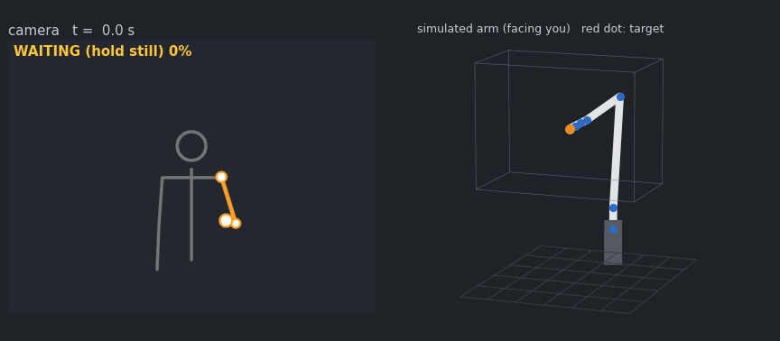

# pose-mimic-arm

**English** | [한국어](README.ko.md)

A simulated 6-axis robot arm that follows your arm. A webcam sees you, [MediaPipe Pose](https://developers.google.com/mediapipe/solutions/vision/pose_landmarker) finds your shoulder, elbow and wrist in 3-D, and the arm in RViz2 moves its tool the way you move your hand, like a mirror. No robot and no depth camera are needed.



*The demo above uses the built-in synthetic person (`source:=synthetic`), so it runs on any machine. The camera view is mirrored, as webcam apps show it.*

ROS 2 Humble · Python · numpy only for the maths (no MoveIt, no KDL)

## How it works

```
webcam / video ──▶ pose_node ─────────────────────▶ ik_node ──────────────────▶ RViz2
                   MediaPipe Pose (3-D landmarks)    motion smoother            robot_state_publisher
                   arm mapper: zero, filter, clamp   damped least-squares IK
                        │ /mimic/target (PointStamped)    │ /joint_states
```

1. **Find the arm in 3-D from one webcam.** MediaPipe's *world landmarks* give shoulder, elbow and wrist in metres, so no depth camera is needed. The hand is taken relative to the shoulder, which means swaying or stepping does not move the robot.
2. **Start without a jump.** The robot waits until you hold your arm still for 2 s and uses that pose as zero. From then on, the tool target is `home + 0.6 × (hand − hand at zero)`, in mirror axes.
3. **Filter in order.** A 7 mm deadband around zero, a 5 cm cap on movement between frames (one bad detection cannot fling the arm), an exponential moving average (α = 0.4), and a clamp to the reachable workspace.
4. **Lose track safely.** If the arm leaves the view, the robot holds still. After 3 s it waits for a new zero, so someone stepping back in somewhere else does not yank it across.
5. **Move like a robot can.** At 30 Hz `ik_node` averages the last 4 targets, then limits speed to 0.8 m/s and acceleration to 4 m/s².
6. **Solve the joints.** Damped least-squares IK puts the tool on the target with its tip pointing at you and leaves roll free. The arm geometry is read from the same URDF that RViz draws, so the two cannot disagree.

### Mirror mapping

| You (seen by the camera) | Robot tool |
|---|---|
| hand toward the camera | reaches toward you (+x) |
| hand up | up (+z) |
| hand to your left | to its right, which is your left as you face it |

The mapping is one parameter, `axis_map` (default `-z,-x,-y`). Each entry names the camera axis that drives robot x, y and z.

## Quick start

Requires Ubuntu 22.04, ROS 2 Humble and Python 3.10.

```bash
mkdir -p ~/mimic_ws/src && cd ~/mimic_ws/src
git clone https://github.com/kimmandy/pose-mimic-arm.git
pip install mediapipe            # tested with 0.10.21
cd ~/mimic_ws && colcon build --symlink-install
source install/setup.bash

ros2 launch pose_mimic_arm sim.launch.py                       # synthetic person, no camera
ros2 launch pose_mimic_arm sim.launch.py source:=webcam        # your webcam (/dev/video0)
ros2 launch pose_mimic_arm sim.launch.py source:=video video_path:=$HOME/clip.mp4
```

With a webcam: stand 1.5 to 2.5 m away so your upper body is in view, hold your right arm still with the hand in front of you until the status turns `FOLLOWING`, then move. Add `show_window:=true` for an OpenCV window where `r` re-zeros, and `arm:=left` to follow the other arm.

## Measured

On a laptop (Intel i5-1340P), single-threaded Python:

| What | Result |
|---|---|
| IK, 500 random reachable poses near home (position + orientation) | 500/500 converged, median 6 iterations, 1.4 ms per solve |
| IK, 2,000 random targets in and around the workspace, clamped, solved in sequence | 2,000/2,000 within 1 mm |
| Full pipeline, 24 s synthetic run at 30 Hz | 0/720 frames unreached, IK 0.37 ms avg |
| Tool behind the target while following | p50 3.7 mm, p95 18.4 mm (deliberate lag from the speed and acceleration limits) |
| ROS 2 run (`ros2 launch`, synthetic) | `/joint_states` 30 Hz; `ik_node` reports 1.8 to 7.2 mm average tracking error per 5 s window |

## Design notes

Choices that came out of measurements rather than guesses:

- **Workspace = box ∩ sphere.** A plain box around home looked fine, but 16 of 512 grid points were out of reach: the far top corners lie beyond the arm's 0.75 m reach from the shoulder. Worse, when a target was out of reach, the solver stayed stuck against a joint limit after the target came back. The workspace now also clamps to a 0.72 m sphere. IK restarts from home if the warm start fails.
- **Adaptive damping.** With fixed damping (λ = 0.05), 1 in 500 solves crawled through its last millimetre and hit the iteration cap. Scaling λ with the error fixed that (500/500) and cut the median iterations from 7 to 6.
- **Tool direction, not full orientation.** Fixing all three rotation axes shrinks the usable workspace. Only the tool's pointing direction is constrained, so the wrist can roll as needed.
- **Camera axes checked on real footage.** MediaPipe world landmarks correlate with image coordinates at +0.99 to +1.00 (x, right) and +0.55 to +0.99 (y, down) across frames, which confirms the axes the mapping assumes.

## Topics

| Topic | Type | From | Content |
|---|---|---|---|
| `/mimic/target` | `geometry_msgs/PointStamped` | pose_node | tool target in `base_link` (m) |
| `/mimic/state` | `std_msgs/String` | pose_node | `WAITING 40%`, `FOLLOWING`, `LOST` |
| `/mimic/image` | `sensor_msgs/Image` | pose_node | camera view with the tracked arm |
| `/joint_states` | `sensor_msgs/JointState` | ik_node | joint angles for RViz |
| `/mimic/tcp` | `geometry_msgs/PointStamped` | ik_node | where the tool actually is |
| `/mimic/markers` | `visualization_msgs/MarkerArray` | both | your arm, target, tool, workspace |

`/mimic/target` is the hand-off point: a real arm's Cartesian servo interface could subscribe to it instead of `ik_node`.

## Parameters

`pose_node`: `source` (synthetic / webcam / video), `camera_index`, `video_path`, `arm`, `gain` (0.6), `axis_map`, `home` ([0.45, 0, 0.55] m), `still_seconds` (2.0), `deadband` (0.007 m), `max_jump` (0.05 m), `ema_alpha` (0.4), `lost_reset_seconds` (3.0), `workspace_lower` / `workspace_upper` / `workspace_center` / `workspace_radius`, `mirror_view` (true), `show_window` (false).

`ik_node`: `rate` (30 Hz), `smooth_window` (4), `max_speed` (0.8 m/s), `max_accel` (4.0 m/s²), `orientation` (axis / full), `home_joints`, `urdf_path`, `target_timeout` (1.0 s).

## Layout

```
pose_mimic_arm/
  kinematics.py   URDF chain, FK, Jacobian, damped least-squares IK
  mapping.py      arm -> target state machine, workspace
  filters.py      EMA, deadband, step limit, motion smoother
  pose_source.py  MediaPipe (webcam / video) and synthetic person
  pose_node.py    ROS 2 node: camera -> /mimic/target
  ik_node.py      ROS 2 node: /mimic/target -> /joint_states
urdf/mimic_arm.urdf   the arm (shared by IK and RViz)
launch/sim.launch.py  everything plus RViz2
tools/render_demo.py  renders docs/demo_sim.gif without ROS or a display
test/                 26 unit tests
```

## Tests

```bash
python3 -m pytest test      # needs numpy only, not ROS or a camera
```

## Limitations

- Follows one arm, and only the hand position. The tool keeps pointing at you.
- No collision checking. The workspace clamp is the only guard.
- Depth (toward or away from the camera) from a single webcam is noisier than left-right and up-down, so reaching motions jitter more.

## License

MIT, see [LICENSE](LICENSE). MediaPipe is a separate dependency under Apache 2.0.
